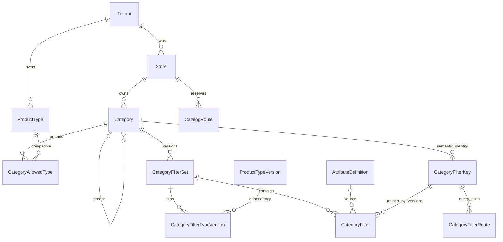

# Milestone 3 — Store categories and versioned filters

Implemented on `feature/commerce-categories-filters`, based on Milestone 2
`c25d111`. This is configuration infrastructure, not a product database or a live
search engine. All migration and browser verification uses disposable loopback
PostgreSQL. No production migrations, catalog updates, deployments, cloud actions,
or scheduled operations are part of this milestone.

## Ownership and persistence



All category references carry store and tenant ownership in compound foreign
keys. A caller cannot reassign either through DTOs. The store URL resolves its
tenant through the authenticated user's membership; headers and request bodies
cannot choose the tenant. Product Types and attributes remain tenant-owned and
reusable across stores. Categories are navigation, not Product Types.

The additive migration `202611010003_categories_filters` adds eight tables, enums,
relations, indexes, checks and triggers; adds `Store.currency` with default `PKR`;
and leaves all existing identity, schema, product and authentication records
untouched. There are no actual Product, SKU or ListingCategory tables here.

`Category` has a permanent UUID/code, store-unique slug, parent, description,
image/banner metadata, SEO metadata, order, visibility/navigation settings,
compatibility, lifecycle, revisions and audit actors/timestamps. Draft metadata
and `parentId` are separate from the last activated `activeSnapshot` and
`activeParentId`. Editing or moving an active category opens a draft without
changing its published hierarchy. Activation validates the published graph again.
Archived nodes retain history and reserved routes. The API offers no hard delete.

Limits are explicit: at most 32 levels and 1,000 category records per store,
including archived history; trees declare truncation at a requested smaller
depth. Lists have page sizes up to 25. These are safety limits, not a fixed
industry hierarchy. Raising limits requires reviewing graph/query costs first.
Moves use optimistic revisions and serializable transactions with the existing
authorization mutation lock. Database triggers also enforce ownership, cycles,
depth, published-parent validity and archival child protection. Concurrent
opposing moves cannot commit a cycle.

Archival blocks while nonarchived draft or published children, an active filter
set, unknown listing usage, nonzero listing usage or usage blockers exist.
`CategoryUsageService` deliberately reports `NO_LISTING_MODEL`: zero is valid only
while listings do not exist. Replace this adapter with scoped real usage queries
before introducing listing persistence or a public cutover. Unknown usage must
remain blocking.

## Category compatibility and future assignments

`ANY` accepts all Product Types and requires an empty allowlist. `ALLOW_LIST`
accepts any of several approved tenant Product Types. Restrictions are validated
at edit and activation; an active filter set cannot be stranded by a category
compatibility change. There is no one-category/one-type assumption.

Future `ListingCategory` must have a unique `(listingId, categoryId)` and compound
store/tenant foreign keys to both sides, allowing many categories per listing.
Publishing assignments must validate the listing's Product Type against each
category's activated compatibility snapshot. Moves and compatibility changes
must run real usage-impact checks before activation. Product schema approval and
store merchandising approval remain distinct authorities.

## Filter versions and dependency compiler

Lifecycle: `DRAFT → REVIEW → APPROVED → ACTIVE → ARCHIVED`. Review may return to
draft; approved configurations require cloning for edits. One draft and one
active configuration per category are database-enforced. Active and reviewed
child rows/dependencies are immutable, including through direct database writes.
Activating a successor atomically archives its predecessor, updates the category
pointer and increments `filterRevision`. A deferred constraint verifies the active
pointer. Two candidates using the same observed filter revision cannot both win.

Each filter set pins explicit approved/active Product Type versions (one per
Product Type). Filter fields pin immutable approved attribute snapshots, not
current mutable labels or option definitions. The compiler checks:

- Tenant/store ownership, category compatibility, public visibility, active source
  attributes and option sets, approved schema versions and matching PRODUCT/SKU
  binding scope.
- Compatible data types and numeric dimensions across every applicable schema.
  Registered exact conversions only; unsupported units and precision loss fail.
  Approved schema bounds constrain configured ranges. Mixed compatible bounds
  form a union; the eventual persistence engine must still validate each SKU
  against its own pinned schema.
- Enum choices from approved snapshots; conflicting option IDs/labels/swatches
  for the same code are rejected. Text facets require approved literal vocabulary.
- Declarative controls: checkbox group, single select, multi-select, numeric range,
  boolean toggle. Operators come from the control registry, not arbitrary input.
  Numeric controls use `gte/lte`, single/boolean use `eq`, ordinary facets use `in`.
  Boolean false, numeric zero and missing remain distinct.
- Built-ins: approved SKU selling price in the store currency; product-level
  controlled brand literals; verified SKU availability (`in_stock`,
  `out_of_stock`, `unknown`). Brand literals are temporary controlled references,
  not an invented Brand database. Reference prices never satisfy selling-price
  predicates. No currency conversion is implied.
- Safe UI metadata contains only `collapsed`; groups, labels, help and ordering
  are plain text. No scripts, SQL, regex programs or executable templates exist.

Limits: 20 filters and 20 pinned type versions per set, 50 choices per filter,
5 aliases per field, 20 query facets and 20 values per query facet. The existing
BFF 16 KiB mutation limit remains enforced, so configurations with unusually long
metadata may need fewer fields/choices. There are no live facet counts.

Current source privacy/archival is checked when retrieving an active contract or
previewing, so a source made private does not leak through an old public snapshot.
Impact reports block reactivation and explain invalid dependencies. Superseded,
formerly approved schema versions remain pinned for existing active contracts
with warnings; new activation requires current approved dependencies. Snapshot
values are never silently replaced by current vocabulary.

## Stable query identities and same-SKU semantics

`CategoryFilterKey` owns immutable meaning (source, attribute, level, data type,
dimension, display unit and operator semantics). Codes and aliases reserve that
key permanently per category. Reusing a code for a different meaning is rejected,
even if it was removed. A new unit or semantic operator requires a new code/key.
Allowed values/ranges may narrow in a successor with explicit impact warnings.
Renaming a field keeps its key; previous published codes resolve to the new
canonical code. Removed fields remain reserved but their queries reject.

Aliases reserved by a draft are not published until activation. Draft preview can
exercise them, while active public contracts accept only published aliases.
Canonical URL parameters use repeated facet values, sorted keys/values, exact
decimal strings, and `min..max`, `min..`, or `..max` numeric syntax. Mixing alias
and canonical code or duplicate/unsupported values rejects instead of guessing.

The compiler emits an adapter contract, never SQL:

```text
category IDs (optionally including descendants) and compatibility policy
AND every product-level predicate
AND EXISTS one ACTIVE, VALID SKU satisfying ALL SKU-level predicates
```

Ordinary values within a facet are OR; distinct facets are AND. Color from SKU A
and sensor/price/stock from SKU B cannot combine into a match. Explicit
`availability=in_stock` requires that same SKU to have verified positive stock;
without it, valid out-of-stock variants may be browsed. Missing/unknown inventory
never counts as verified in-stock. This milestone tests that contract with
synthetic fixtures, including false, zero, dependent combinations and
reference-only prices. It does not claim that real SKU queries exist yet.

The preview's hardware/fashion/vehicle choices name generated synthetic datasets
derived from the selected schema. They are not imported products, actual stock,
price evidence or industry-specific runtime behavior. The evaluator is only a
test/preview adapter. A later engine must implement one correlated SKU `EXISTS`
and verify the same contract before public cutover.

## API and RBAC

Nest base: `/api/admin/stores/:storeId`. All routes require the existing server
BFF credential, valid session, active tenant/store membership and context-specific
permissions. Examples below are relative to this base.

| Method | Path | Permission |
|---|---|---|
| GET | `/categories`, `/categories/tree`, `/categories/:id`, `/categories/:id/impact` | `categories.view` |
| POST | `/categories` | `categories.create` |
| PATCH | `/categories/:id` | `categories.update` |
| POST | `/categories/:id/move` | `categories.reorder`; also update when parent changes |
| POST | `/categories/:id/actions/review` or `draft` | `categories.update` |
| POST | `/categories/:id/actions/approve`, `activate`, `archive` | corresponding `categories.*` |
| GET | `/filter-registry`, `/filter-schemas` | `category-filters.view` |
| GET | `/categories/:id/filter-sets[/:setId[/impact]]`, `/active-filters` | `category-filters.view` |
| POST | `/categories/:id/filter-sets`, `/:setId/clone` | `category-filters.manage` |
| PATCH | `/categories/:id/filter-sets/:setId` | `category-filters.manage` |
| POST | `/categories/:id/filter-sets/:setId/preview` | `category-filters.view` |
| POST | `/categories/:id/filter-sets/:setId/actions/review`, `draft`, `archive` | `category-filters.manage` |
| POST | `/categories/:id/filter-sets/:setId/actions/approve`, `activate` | corresponding filter capability |

Archiving the active filter set additionally requires `category-filters.activate`
and an observed `categoryRevision` equal to `filterRevision`. Activation requires
that revision too; it is returned by impact analysis. Other writes use the
resource `revision`. Stale/conflicting identity/lifecycle writes return 409,
invalid DTO/compiler/hierarchy inputs 400, missing scoped resources 404, and
missing capabilities/membership 403. Internal database diagnostics are not sent.

The names follow the existing `.view` registry convention in place of `.read`.
Legacy `categories.manage` does not imply the new granular capabilities. Custom
roles need explicit grants; category/filter navigation requires relevant read
rights. Grant both `categories.view` and `category-filters.view` for a usable
filter workspace. Store staff can read eligible public approved schemas for
filter configuration without acquiring tenant-wide schema-edit permission.
New capabilities require an explicit reviewed RBAC provisioning step outside
development; the migration does not silently grant custom roles new authority.

GET `/api/admin/contexts/catalog` lists up to 50 authorized store contexts.
Existing tenant-qualified RBAC APIs remain unchanged. Privileged operations use
scoped audit events `category.*`, recording actor/resource/store/tenant without
passwords, database URLs or session tokens. A malicious body cannot change context.

The Next.js BFF adds only explicit category/filter paths and methods. Collection
query forwarding is bounded by strict Nest DTOs. HttpOnly cookies, same-site
sessions, Origin/CSRF checks, request size bounds, session expiry and preview
fail-closed behavior remain intact. There is no arbitrary URL proxy.

## Admin workflow

Open `/categories` in the existing admin shell, choose an authorized store, search
or filter categories and inspect draft/published hierarchy. Add/edit metadata,
compatibility and navigation visibility. Hierarchy/order has a separate save and
permission check; review category impact before archive. Categories publish
through review, approval and activation.

For a category, create a filter draft or clone a reviewed/active version. Choose
approved schemas (paginated eligible reads), select shared attributes or built-ins,
configure controls, values, units, grouping/order and aliases, then save. Validation
and comparison display added/removed/changed fields and dependency warnings. Run
synthetic previews and inspect the query contract. Review, approve, compare again
and activate. Active versions are read-only. Unsaved changes block preview and
publishing; stale revisions require reloading the configuration. A store switch
remounts editors to discard the previous context's local state.

Media configuration stores approved local `/images/` metadata only; no upload or
external fetch service was introduced. Form permissions improve UX; the backend
remains the authorization boundary. Mobile and desktop workflows are verified
using the real built admin and real isolated Nest API, not mock authentication.

## Static storefront compatibility and cutover gates

The existing static data sources are unchanged: 12 categories, 84 products and
all existing `/products/[slug]` and nested product paths. Storefront pages do not
read these new tables. New categories therefore do not appear publicly yet.

`CatalogRoute` reserves one owner per store/slug across category/product/legacy
identities. Slug edits preserve old reservations. Ownership cannot be stolen or
deleted. A future reviewed legacy-category adoption may transfer the matching
legacy identity; no such production transfer happens here.

`backend/scripts/reserve-legacy-routes.mjs` creates the 96 static namespace
reservations **only in an explicitly confirmed loopback development/test DB**.
It checks actual connection identity, validates all slugs, is transactional and
idempotent, and stops on conflicting ownership. It never imports listings or
changes source data. Example, using an already securely configured disposable
environment (never paste a connection string into logs):

```powershell
cd D:\work\coding\vog\backend
node scripts/reserve-legacy-routes.mjs <tenant-uuid> <store-uuid> --confirm-isolated-development
```

Before a future production cutover: inventory all current routes; reserve legacy
ownership under an independently approved migration; reconcile conflicts rather
than reassigning; implement ListingCategory and usage analysis; add a public
active/visible-only resolver with archive/redirect semantics; implement database
same-SKU search/facets; then switch reads with cache invalidation so new categories
can resolve without a rebuild. No new category may capture a legacy product URL.

## Verification and remaining boundaries

Reproduce with no production DB configuration required:

```powershell
cd D:\work\coding\vog\backend
npm run test:categories
npm run test:foundation
npm run lint
npm test
cd ..\admin
npm run lint
npm run test:routing
npm run test:preview
node scripts/test-scoped-routes.mjs
cd ..\frontend
npm run lint
npm run build
```

The category harness runs the Milestone 2 regression suite as well, creates fresh
random-port PostgreSQL and Nest processes, and builds an env-free admin fixture.
Credentials are random/in-memory. It stops/removes the cluster and fixture on
completion, including failures. No caller-provided production database is used.
It also applies the new SQL to a populated Milestone 2 database to verify additive
compatibility. Embedded PostgreSQL is 18.4 on this Windows machine; this is not an
Oracle/production deployment verification.

Evidence: `backend/docs/categories-verification.json`,
`categories-auth-regression.json`, `categories-foundation-regression.json`, and
`categories-security-report.json`. The security report records dependency audit,
secret-scan scope and validation outcomes; historical milestone evidence is
preserved. No generated clients, fixture builds, secrets or untracked frontend
assets are part of the commit.

Remaining boundaries are deliberate: real product/SKU/listing usage checks,
public read routing, database search/facet counts, media uploads, brands, new
tenant onboarding, production capability provisioning and deployment are later
work. Stage 4 automation remains disabled. Stop after this milestone for review.
