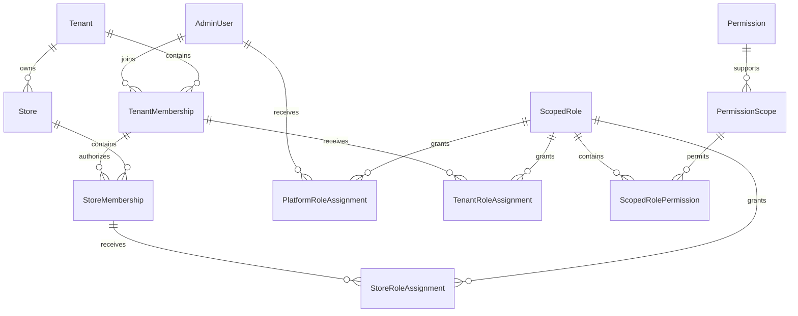

# Milestone 1 — commerce ownership and scoped authorization

Status: local implementation and disposable database verification only. No production migration, deployment, tenant backfill or credential changes have been performed. Milestone 2 is not implemented.

## Ownership and relational boundaries

`AdminUser`, Argon2 password hashes and opaque `AdminSession` records retain their existing identities and contracts. `TenantMembership` links an identity to a tenant; `StoreMembership` requires both that tenant membership and a store belonging to that same tenant. Memberships and their parent tenant/store must all be active.



`ScopedRole` owns exactly one PLATFORM, TENANT or STORE scope. Nullable owner columns are constrained by SQL CHECKs. Partial unique indexes enforce role-code uniqueness within the owning scope. Compound assignment foreign keys include the role's scope, tenant and store; a forged discriminator or cross-tenant nested write cannot bypass ownership. Store role ownership is independent of tenant role ownership: tenant roles do not automatically grant store access, and platform roles do not automatically grant tenant/store access.

`Permission` is the existing code registry. `PermissionScope` and `ScopedRolePermission` enforce scope compatibility relationally; the server-owned `SCOPED_PERMISSIONS` registry also rejects unregistered capabilities. Runtime callers cannot define executable permission logic. New capabilities for Product Types, listings and pricing are registered but no business endpoints are implemented.

The retained legacy `Role`, `RolePermission` and `AdminUserRole` tables deliberately coexist with `ScopedRole`. This is a bounded compatibility strategy, not two competing role systems for new features. New features use scoped roles exclusively. No legacy `SUPER_ADMIN` becomes a platform administrator.

## Authorization and delegation

- `ScopedAuthorizationService.resolve/require` reload active user, tenant, store, memberships, assignments and current permission grants. There is no permission cache or persistent authorization claim in the session.
- Multiple roles union permissions only within the requested context. Having a permission does not imply permission to delegate it: `canDelegate` is explicit per grant.
- Role creation/replacement and assignment replacement require contextual management permissions. New grants and existing elevated grants being changed must fall inside the actor's delegation boundary. Scope fields, system flags and Owner designation cannot be supplied through role DTOs.
- System/Owner roles cannot be edited through custom-role APIs. Assigning/removing an Owner role requires an existing contextual Owner. Owner is an explicit protected role property, not a role-code convention in the generic engine.
- Every privileged write reauthorizes inside a serializable transaction, takes the same advisory transaction lock as legacy staff operations, audits its scope and retries up to two serialization conflicts. A failed owner/delegation check rolls back all changes.
- Store assignment removal, store membership revocation, tenant membership revocation and legacy staff mutation verify a surviving active authorized store Owner. Tenant revocation additionally requires delegated staff/role administration in each affected store. Tenant/store activation, global user administration and membership provisioning are not exposed by these new APIs.
- `@ScopedAccess()` establishes verified context; `@RequireScopedPermissions(...)` supports reusable permission checks on future controllers. These decorators must be paired for future scoped controllers. Business mutation services must still recheck permissions and resource ownership inside their transaction.
- Future Product Type/catalog services must include tenant keys in every query, join, count, aggregate, export and write. Future store services must include tenant + store. Authentication middleware alone is not a resource-isolation boundary. No catalog tables or generic unscoped repository helpers were introduced here.

SQL constraints enforce structural ownership. Privileged database operators can still change membership state or grants directly: runtime credentials, reviewed migrations and service-layer checks remain part of the trust boundary. PostgreSQL RLS is not implemented in this milestone; evaluate restricted runtime roles and transaction-local RLS before enabling real additional tenants. No SaaS onboarding is enabled.

## Safe legacy compatibility

`LegacyStoreBridge` is a constrained singleton identifying only the default VOGPK context. Development initialization creates it explicitly, along with memberships for existing legacy-role holders. It never rewrites hashes, sessions, legacy roles, role grants, existing assignments, account status or revoked memberships.

Legacy permissions contribute only in the bridged tenant/store, filtered by supported scope. Only the existing system Owner receives the newly registered default-context capabilities and delegation for permissions they hold; no platform capability is inherited. Generic scoped roles are never added to the old global identity permission union.

Existing login/logout, `/auth/me`, cookie names, Origin/BFF checks and CSRF behavior retain their contracts. Old default-context protected routes additionally validate membership once the bridge exists. Legacy staff listing remains limited to default-context legacy identities, legacy permissions list remains the original registry, and legacy audit listing excludes other tenants/platform events. Global legacy account editing refuses users with scoped assignments or memberships outside the default context; use scoped administration for those users. Old clients may still display legacy menu permissions after membership revocation, but protected operations are denied immediately by the backend.

There is no production bridge/backfill in the migration and no startup auto-initialization. A future production rollout needs a separately approved, reviewed backfill that binds the existing Owner and legacy staff to the correct context. Do not run the development initializer against Neon or rerun the legacy RBAC seed as a migration procedure.

## APIs

All below remain behind the existing BFF secret and real opaque session authentication. URLs carry the context; arbitrary scope headers have no authority. Strict DTOs reject unknown fields.

Base prefixes:

- `/api/admin/scopes/platform`
- `/api/admin/scopes/tenants/:tenantId`
- `/api/admin/scopes/tenants/:tenantId/stores/:storeId`

| Method / suffix | Authorization / behavior |
| --- | --- |
| GET `/access` | Active contextual membership; platform assignment required for platform introspection |
| GET `/permissions` | Contextual roles.view (platform.roles.view for PLATFORM); registered scope-compatible codes |
| GET `/roles` | Same permission; bounded at 100, stable code/id order, scoped nested grants |
| POST `/roles` | roles.manage; strict code/name/grants; each grant includes code and canDelegate |
| PATCH `/roles/:id` | roles.manage; full name/grants replacement; owned role and delegation required |
| POST `/members/:id/roles` | roles.manage + staff.manage; replaces only this scope's assignments, maximum 20 role IDs |
| POST `/members/:id/revoke` | roles.manage + staff.manage; empty JSON; tenant/store memberships only |

Platform management uses `platform.roles.manage` / `platform.staff.manage`. `GET /api/admin/contexts` returns at most 100 active tenant memberships and their active stores for the authenticated identity only. No arbitrary staff search, tenant creation, platform bootstrap, role deletion, membership creation/reactivation or publication endpoints are exposed. Listing pagination is intentionally bounded for foundation administration; add cursor pagination before large tenant/staff directories are introduced.

The admin BFF has an explicit method/path allowlist for these APIs. Existing HttpOnly/SameSite cookies, streamed 16 KiB body cap, mandatory Origin + CSRF on mutations, preview fail-closed configuration and no-store behavior apply. There is no new admin screen or context switcher yet.

## Development commands and migration safety

From `backend`:

```powershell
npm run db:validate
npm run test:foundation
npm run lint
npm test
```

`test:foundation` builds the backend, starts a new random-port PostgreSQL 18 cluster using the already-installed embedded-postgres dependency, uses randomized credentials only in memory, applies migrations to empty disposable databases, runs the legacy fresh authentication suite, and verifies the new foundation against real HTTP and relational constraints. It also builds/runs an environment-free copy of the admin application against the isolated API. Generated cluster and admin build files are removed and processes stopped in cleanup. No caller-provided database connection is used by this test runner. It does not require Docker or access to Neon.

For an already migrated disposable development database, set `NODE_ENV=development`, configure the existing loopback `DATABASE_URL` with a database name ending `_dev` or `_test`, then run `npm run foundation:init:dev`. The initializer verifies the actual database name and server address as well as the URL/environment before writing. It is idempotent and does not restore revoked memberships. Migrations are development/test-only at this stage. Do not invoke existing generic `db:migrate` commands with production credentials for this milestone.

The additive migration adds tables and nullable audit metadata, with no data deletion or catalog/authentication rewrite. Verification includes applying that SQL to populated pre-foundation tables and checking retained password hashes, sessions and legacy assignments, as well as Prisma migrate deploy on a fresh database. PostgreSQL CHECKs and partial indexes are maintained in migration SQL because Prisma schema syntax cannot express them. Prisma schema-only diffs do not fully verify those constraints.

## Changed-file inventory

| File | Purpose |
| --- | --- |
| `backend/prisma/schema.prisma` | Ownership, memberships, scope registry, custom roles, assignments and scoped audit relations |
| `backend/prisma/migrations/202611010001_commerce_foundation/migration.sql` | Additive development migration, composite FKs, CHECKs and partial uniqueness |
| `backend/src/security/scoped-permissions.ts` | Server-owned scope/capability registry and context types |
| `backend/src/security/scoped-authorization.service.ts` | Fresh authorization resolution, delegation, transactional writes, owner protection and auditing |
| `backend/src/security/scope-request.ts` | Validate route-owned UUID context, ignoring forged headers |
| `backend/src/security/scoped.controller.ts` | Minimal context/custom role/assignment/revocation APIs |
| `backend/src/security/development-foundation.ts` | Guarded idempotent default tenant/store initialization and legacy bridge |
| `backend/src/security/guards.ts` | Scoped decorators and context checks; legacy default membership enforcement |
| `backend/src/security/security.module.ts` | Register/export scoped services and controllers |
| `backend/src/security/staff.service.ts` | Keep legacy staff API within its default context and protect authorized Owners |
| `backend/src/security/admin.controller.ts` | Restrict legacy permissions/audit reads to their compatibility boundary |
| `backend/scripts/initialize-foundation.ts` | Explicit development-only initialization CLI |
| `backend/scripts/test-foundation.mjs` | Disposable PostgreSQL migration/isolation/delegation/Owner/HTTP tests and cleanup |
| `backend/scripts/foundation-admin-regression.mjs` | Real isolated Next production build and BFF/cookie/CSRF regression |
| `backend/scripts/test-security-fresh.mjs` | Allow an ephemeral test port and preserve safe progress output on failures |
| `backend/scripts/test-security.mjs` | Allow a separate sanitized report path; existing default behavior unchanged |
| `backend/package.json` | Add foundation init and complete integration test commands; no dependency changes |
| `admin/src/lib/scoped-routes.js` | Narrow scoped API proxy allowlist |
| `admin/src/app/api/admin/[...segments]/route.js` | Route allowlist integration, preserving existing security flow |
| `admin/scripts/test-scoped-routes.mjs` | Negative security checks for traversal, unsupported methods and unapproved provisioning routes |
| `admin/scripts/test-preview-http.mjs` | Extend the existing real secret-free preview regression to new foundation routes |
| `backend/docs/commerce-foundation-auth-regression.json` | Sanitized existing authentication regression evidence |
| `backend/docs/commerce-foundation-verification.json` | Sanitized migration/scoped authorization/admin regression evidence |
| `docs/COMMERCE_FOUNDATION.md` | This runbook, boundaries, migration approach and remaining work |

## Milestone 2 readiness and remaining review points

Final local verification (2026-11-01, Asia/Karachi):

| Check | Result |
| --- | --- |
| Prisma schema validation and Nest production build | PASS |
| Backend lint and unit suite | PASS — 9 tests in 3 files |
| Real legacy authentication regression | PASS — 25 checks |
| Fresh PostgreSQL migration + populated-schema upgrade + scoped foundation | PASS — 23 integration groups, PostgreSQL 18.4 provided by installed embedded-postgres |
| Real isolated admin production build and BFF regression | PASS — 15 HTTP/cookie/CSRF assertions plus build, included in foundation evidence |
| Admin lint and existing routing configuration regression | PASS — 19 routing checks |
| Scoped BFF path-injection/provisioning/method negative checks | PASS — 57 assertions |
| Preview configuration and real secret-free Preview build/HTTP regression | PASS — 10 configuration checks + 31 build/HTTP checks, zero backend requests |
| Temporary database/API/admin cleanup | PASS — stopped and generated disposable cluster/build directories removed |
| Staged change secret scan | PASS — Gitleaks 8.30.1, no findings; forbidden credential/backup paths and private-key markers checked separately |

Evidence files contain synthetic test summaries only. PostgreSQL 18.4 is the local test dependency's version, not a claim of a new production PostgreSQL 18.6 test or migration. No production integration tests were attempted in this milestone. The test runner explicitly preserves nonzero failure exit status despite embedded-postgres's existing beforeExit hook.

Ready for development of Product Types and dynamic attributes against this foundation, subject to successful final local verification. Existing 84 products, category definitions, static assets, product URLs and storefront code are unchanged. The separate Stage 4 operations commit/branch is preserved; dormant schedules and deployment automation are not activated.

Remaining deliberate boundaries:

1. Production migration/backfill and deployment require separate approval. Current running infrastructure is unchanged.
2. Production platform-role bootstrap is intentionally absent; a default store Owner cannot acquire platform authority.
3. Initializing new tenants/stores, provisioning/reactivating memberships, protected Owner-role creation/transfer UI, custom-role UI and context switching are later admin milestones. Test fixtures provision additional scopes directly in disposable databases only.
4. Resource-specific grants and restrictions will be concrete joins once catalog/resource models exist. There are no fictional Product/Category ownership checks or placeholder business endpoints in this milestone.
5. Before real multi-tenant activation: review RLS/runtime database privileges, bounded-directory pagination, cross-tenant media/cache/export behavior and the retirement plan for legacy global staff administration.
6. The authorization write lock is deliberately conservative and serializes low-volume administrative changes. Revisit lock partitioning with per-tenant owner invariants if concurrency warrants it.

No Milestone 2 schema, product, filter, checkout, billing or SaaS infrastructure is included.
