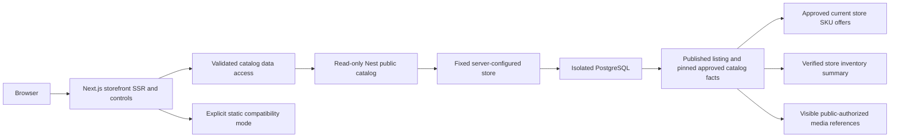

# Milestone 6 — Dynamic development storefront

Branch `feature/commerce-storefront-integration`, based on `b6d088f`.
This implements and verifies development integration. The existing static catalog
remains the default. No production migration, import, deployment, provider
activation, checkout or operational automation is included.

## Data flow and publication boundary



Public requests cannot select a tenant/store through IDs, Host, Origin, cookies
or custom headers. `PUBLIC_CATALOG_STORE_ID` selects one store in trusted backend
configuration. The store and its tenant must be active. The development API also
requires a loopback `_dev`/`_test` database and rejects production execution.
There is no domain-registration or tenant-onboarding endpoint.

Each catalog read uses a repeatable-read transaction, an 8-second SQL statement
timeout and a 15-second transaction bound. Listing identity must point to its
visible published revision, with approval/publication evidence. Product identity
must remain nonarchived, and the exact pinned product revision must retain
approval evidence. Published historical product pins remain usable when a newer
product revision is published. Archived Product Type configurations and invalid,
private or archived variant-axis definitions fail closed.

Category metadata and hierarchy come from activated snapshots and active parent
links, including while a new metadata draft is being edited. Hidden/archived
ancestors hide their descendants. Category recursion is bounded at 32 levels and
1,000 records. Cards require assignment to a visible published category.

Responses explicitly project public fields. They do not serialize Prisma/admin
objects, draft histories, internal proposals, approval actors, procurement data,
storage paths, rights evidence, credentials, movement history or stock counts.
Inventory is exposed as availability, not warehouse quantities. No public endpoint
mutates application records or accepts an admin session to expand its scope.

## Public API

All routes begin `/api/catalog`, are GET-only and require no admin authentication.
Unknown query keys and repeated/invalid scalar parameters are rejected.

| Route | Public contract |
|---|---|
| `/navigation` | Store display identity; activated visible category metadata/hierarchy |
| `/listings` | Paginated cards, category metadata, approved filters and distinct-product facets |
| `/routes/:slug` | Published category/product canonical route or historical alias |
| `/products/:slug?variant=:skuCode` | Exact published product/listing, specifications, axes, valid offered SKUs, prices, availability and media |
| `/media/:slug/:asset?width=320` | Rights-checked development WebP derivative only |

Listing query fields: `category`, `collection` (`featured`/`new-arrivals`),
`related`, `page` (1–10,000), `pageSize` (1–24, default 12), `sort`
(`editorial`, `name`, `price-asc`, `price-desc`, `newest`), `search` (80 characters),
`filters` (URL-encoded filter pairs, at most 4,096 characters), and `facets`
(`include`/`omit`). Omission avoids count/configuration work for editorial cards;
it never skips validation or application of supplied filter predicates. Category
descendant policy is honored even when facets are omitted.

Example, using approved filter codes:

```text
/api/catalog/listings?category=keyboards&filters=color%3Dwhite%26availability%3Din_stock
```

The specification and variant contracts are embedded in the product response;
there is no endpoint for browsing unpublished Product Type definitions. Related
items are scoped to visible published listings sharing categories and exclude
the source product. Featured/New Arrivals use approved listing editorial fields,
not guessed release dates or automatic assignments.

## Filtering and query execution

Milestone 3's compiler remains authoritative for controls, operators, allowed
values, aliases, type-version applicability and canonical-unit conversion.
Checkbox/multi-select values within an ordinary facet use OR. Distinct facets
use AND. Unsupported values, duplicate aliases/codes, unregistered units and
operators are rejected before SQL execution.

The SQL query joins one exact ListingSKU/SKURevision row. Every SKU attribute,
price and availability predicate refers to that same row. Product predicates
use the pinned product revision. An in-stock white SKU cannot satisfy a request
for an unavailable black SKU, and a cheap black SKU cannot satisfy a white SKU's
price constraint. Cards use prices from the matching SKU set, not an unrelated
cheapest variant.

Approved current store offers and active promotions are evaluated at a common
request instant, using exact decimals. A REFERENCE/RFQ/INFORMATIONAL listing never
exposes a selling offer, even if an administrative StorePrice exists. Available
means the same retail SKU has a valid approved offer and either verified positive
quantity across all active locations or an explicit NON_STOCK policy. Unknown
stock, untracked/serialized policies and missing offers never become confirmed
availability. Actual quantities and location IDs are not returned.

Facet counts remove only the facet being counted, retain other selections, and
count distinct listing/product identities. Aliases are first normalized using
the compiler's canonical query. Counts are evaluated in one batched SQL request,
not one request per product. Numeric range bounds are approved configuration
bounds; no fabricated histogram counts are returned.

All SQL values use Prisma parameters. Identifier/sort fragments are server-owned.
PostgreSQL performs sorting, deterministic UUID tie-breaking, grouping and page
selection. Only the selected page's detailed projections are loaded. The offer
CTE is restricted to the configured store's published offered SKU pins. Query
cost is bounded at 10,000 matching products and 256 discrete facet buckets.
Larger configurations return unavailable rather than partial/inaccurate counts;
raising those budgets requires query-plan and load review.

Development evidence includes 206 published fixtures plus a genuinely published
foreign-store twin with the same slug, and sanitized `EXPLAIN ANALYZE` results for
the real same-SKU query. The additional 200 records are inquiry performance
fixtures seeded through real database constraints; they are not a claim of 200
browser-driven approvals or production-scale load certification. Measured HTTP
and SQL timings are recorded in `backend/docs/storefront-query-performance.json`.

## Routes, aliases and SEO

`CatalogRoute.published` distinguishes a private reservation from a URL that has
actually been published. Category activation and listing publication mark their
canonical route inside the same authorized transaction. PostgreSQL requires
publication evidence and prevents removing that provenance. A draft-reserved
slug returns 404. Previously published aliases resolve only while their current
target remains visible and eligible.

The additive development migration `202611020006_storefront_read_indexes` adds
the flag and two scoped read indexes. Its backfill recognizes only current
activated category slugs and retained published listing history. It does not
guess that other reserved aliases were public. Unknown historical reservations
remain private pending explicit review. No legacy routes are imported or claimed.
No production migration has been applied.

The shared `/products/[slug]` route resolves category versus product at request
time. Build-time `generateStaticParams` and restrictive `dynamicParams=false`
were removed from product/legacy catalog routes. Existing `/products/category/slug`
links retain permanent redirects. Valid variant selections survive dynamic alias
and legacy redirects; invalid variants return not found. URL namespaces remain
protected by immutable route ownership and collision checks.

Dynamic catalog reads explicitly enter Next.js request-time rendering via
`connection()`. Framework control-flow errors are rethrown with
`unstable_rethrow`, never converted to API outages. This avoids static fallback
rendering of live prices, media rights or newly published routes. Static
compatibility product URLs now render at request time from their unchanged local
data; this changes build strategy, not catalog identity, content or canonical URLs.

Canonical metadata uses the existing trusted site configuration, not request
Host. Dynamic development pages are noindex, including filtered/variant views.
Published category/product sitemap entries are resolved at runtime without a
frontend rebuild. Product JSON-LD contains truthful published identity/brand
information and deliberately excludes executable Offers while checkout is disabled.
Legacy reference prices are never emitted as live commerce offers.

## Storefront data access and compatibility

`frontend/src/lib/catalog/` provides Zod-validated response contracts with inferred
JSDoc types, bounded server fetches, public-only errors and React per-render
deduplication. Requests and image responses use no-store; no persistent catalog
cache survives publication, stock changes, offer expiry or rights changes. This
deliberately favors correctness for the development milestone. A production cache
must later include store identity and explicit publication/inventory invalidation.

Two modes are explicit:

- Default `static`: existing catalog helpers and the controlled compatibility
  adapter retain all 84 products, 12 categories, IDs/slugs, specifications,
  reference-only PKR prices, unknown stock, media restrictions and editorial order.
- `dynamic-development`: only the configured development backend is read. Backend
  failures produce empty/unavailable/error states; they never invoke static price
  or stock fallback. Mode selection is deployment configuration, not a customer
  query/header toggle. There is no automatic hybrid production cutover.

`frontend/scripts/catalogue-parity.mjs` compares the unchanged source files against
`b6d088f`, validates adapter identities/reference-price/inventory semantics, and
records Featured/New Arrivals order. It is read-only Milestone 7 preparation,
not a catalog importer or an approval of retailer prices/media. Dynamic REFERENCE
listings without a separately imported reference record show no selling price;
the original numeric retailer references remain preserved in the static source.
Their provenance mapping must be reviewed during the later import.

SSR category pages share configurable controls, URL state, sorting, pagination,
breadcrumbs, subcategory navigation and responsive layouts. Pending filter
transitions and lazy category tabs expose loading states; empty and unavailable
results are distinct. Navbar and Shop footer links use the dynamic navigation
contract only in dynamic mode. Branding, hero, existing CSS and default static
navigation remain intact.

The homepage retains separate Featured/New Arrivals carousels and the tabbed Shop
by Category carousel, each capped at seven products followed immediately by its
View All card. Category cards load on demand through the narrow GET-only
`/api/catalog-category` endpoint; it cannot proxy arbitrary paths or admin APIs.

## Product detail and media

Reusable detail components render product identity, brand, description, categories,
grouped product/SKU specifications, exact units and typed false/zero/unknown values.
Only actual offered SKU combinations exist in the response. Selectors constrain
downstream options and clear incompatible selections. Color-dependent switches
and sensors, size/color combinations, default SKUs, quote-only and informational
policies share the same components. No functional purchasing action is displayed.

Gallery images and long-form posters remain distinct. Shared media is retained
when switching SKUs; configured SKU media supplements it. Ordered posters and
other informational diagrams render below specifications at content width, with
intrinsic aspect ratio, contain fit, alternative text, captions and lazy loading.
Responsive source sets use provider-generated 320/640/1280/1920 derivatives,
deduplicating effective widths for small originals. Missing images show an
accessible fallback. Products with no posters render normally.

Every public media request rechecks the configured store, published listing,
exact valid SKU pins, visible source references, tenant ownership, archive status,
public approval and development-only state in the same read transaction. The
browser receives only the narrow `/api/catalog-media/:slug/:asset?width=...`
delivery URL. The proxy validates fixed paths and registered widths and forwards
no admin credential/cookie. It cannot fetch arbitrary URLs or expose an upload
directory. No source URL or raw storage key is a public image URL.

Local image delivery requires `PUBLIC_MEDIA_DEVELOPMENT=1` and explicit
development/test execution. It serves approved optimized derivatives, never
original/private uploads. Unsupported remote providers produce no fake public
URLs. Category media uses a separate explicitly approved fixture-path allowlist;
legacy metadata paths alone do not grant public rights.

Production media remains **inactive**. Before commercial cutover, select and approve
a provider/plan, implement its server-side adapter, retain asset identity/rights,
define signed delivery and immutable derivative URLs, configure a bounded Next.js
loader or direct CDN delivery, test cache invalidation/revocation and ARM64
processing, and verify costs/quotas. No Cloudinary or other external resource was
configured by this milestone.

## Development configuration

Never use production credentials for the fixture harness. It provisions a fresh
random-port loopback PostgreSQL/Nest environment and environment-free frontend/admin
copies; all credentials remain in memory. There are no hardcoded login credentials.

Backend configuration names (values are intentionally omitted):

```text
NODE_ENV=development or test
DATABASE_URL=<approved loopback database ending _dev or _test>
PUBLIC_CATALOG_MODE=development
PUBLIC_CATALOG_STORE_ID=<approved development store UUID>
PUBLIC_MEDIA_DEVELOPMENT=1
MEDIA_STORAGE_PROVIDER=local-development
PUBLIC_CATEGORY_MEDIA_PATHS=<optional comma-separated reviewed /images/storefront-fixtures/*.webp or *.png paths>
```

Frontend development configuration names:

```text
CATALOG_MODE=dynamic-development
CATALOG_DEVELOPMENT=1
CATALOG_API_ORIGIN=<loopback HTTP API origin, without credentials/path/query>
```

Leaving CATALOG_MODE unset preserves static compatibility. Backend production
execution refuses this development API even if its flag is mistakenly set.
Changing these gates for production requires a separate reviewed Milestone 7
rollout; it is not an environment-only approval to cut over.

## Verification and remaining rollout boundaries

```powershell
cd D:\work\coding\vog\backend
npm run test:storefront
npm run test:foundation
npm run lint
npm test
cd ..\frontend
npm run lint
npm run build
npm run test:catalogue-parity
cd ..\admin
npm run lint
npm run test:routing
npm run test:preview
node scripts/test-scoped-routes.mjs
```

The full storefront harness runs the real Milestones 2–5 regression and admin
browser workflows before the dynamic storefront browser. It covers the keyboard,
mouse, apparel, quote-only vehicle, single SKU and reference listing, same-SKU
filters/facets, canonical units/boolean/brand filters, mixed types, foreign public
twins, media rights, runtime publication, collisions, aliases, archive behavior,
sitemap, mobile/desktop layouts and explicit backend-outage handling. The separate
foundation suite verifies legacy Owner authentication and scoped RBAC. The
framework-only diagnostic used during debugging is excluded from pass evidence.

Sanitized evidence lives in `backend/docs/storefront-*.json` and
`frontend/docs/storefront-static-parity.json`; previous milestone evidence stays
historical. Dependencies add only pinned frontend Zod 4.6.7, matching the backend.
Runtime and development dependency audits are recorded separately. Tests use
Windows x64, PostgreSQL 18.4 and real built Next/Nest applications. Temporary
processes, databases and fixture media are stopped/removed. No production state,
credentials, cloud plan, SSH/firewall/IAM, Stage 4 schedule or Owner account changes.

Milestone 7 may proceed with a reviewed migration rehearsal and parity checks,
after this milestone's final validation/commit. Production cutover still requires
the actual legacy import/provenance mapping, route reservation review, media rights
and provider approval, production migration/backup rehearsal, capacity/load review,
hosting plan review and explicit rollout authorization. Checkout, reservations,
orders, payments, subscriptions and tenant onboarding remain excluded.

Changed-file inventory: the Prisma route-provenance/index migration; backend
storefront controller/service/projection/query/SQL/unit tests; narrow publication
hooks in category/listing services; module and no-store registration; isolated
storefront harness and browser/performance evidence; frontend catalog contracts,
data access, compatibility/parity tooling and reusable UI; runtime route/SEO/sitemap
integration; navigation/footer/carousel integration; frontend Zod dependency; this
guide and sanitized reports. Generated clients, raw databases/logs, `.local`
diagnostics, secrets and unrelated untracked product/video assets are excluded.

Final local verification:

| Check | Result |
|---|---|
| Backend lint/build/unit tests | PASS; 37 tests |
| M2–M6 integration and real built admin/storefront browser | PASS; 61 groups |
| M1 scope / legacy authentication regression | PASS; 23 / 25 checks |
| Admin lint and built-app regression | PASS |
| Admin routing / preview configuration / preview HTTP | PASS; 19 / 10 / 38 |
| Explicit admin BFF allowlist assertions | PASS; 356 |
| Frontend lint and production build | PASS; catalog URLs resolved at request time |
| Static source/adapter/editorial parity | PASS; 84 products, 12 categories |
| Runtime dependency audits | PASS; zero backend/frontend/admin advisories |
| Development dependency audits | 2 backend, 16 frontend and 16 admin moderate toolchain findings |
| Secret scan | Exact staged source and sanitized evidence; see security report |
| Production rollout | Not performed or authorized |

Cleanup note: automatic execution review blocked optional deletion of an earlier
failed test's ignored directory, `backend/.local/product-types/67b04dbf0329e417`,
with the reason “blocked by policy.” It remains excluded from Git. The successful
final run removed its own PostgreSQL, API, admin/storefront and media fixtures.
Any manual removal of that older directory must first verify no process owns it.
