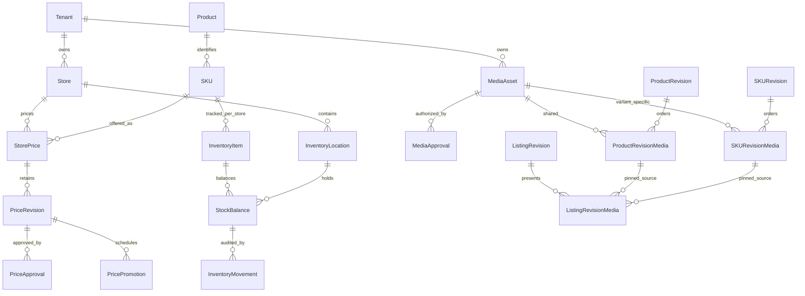

# Milestone 5: Pricing, inventory and media

Development implementation on `feature/commerce-pricing-inventory-media`, based
on Milestone 4 commit `4e20044`. This branch does not deploy, migrate production,
import the legacy catalog, activate automation, or enable purchasing. The public
84-product catalog, its 12 categories and existing URLs remain unchanged.

## Operational ownership and revision boundaries



StorePrice and InventoryItem use permanent catalog SKU identity, not transient
SKURevision IDs. Compound foreign keys retain tenant/store/product/SKU ownership.
Listing presentation instead pins the exact approved product revision and exact
selected SKU revision. It cannot accidentally switch colors when a newer product
revision is published. There is no cross-tenant asset reuse or implicit grant.

Catalog edits never write operational prices or stock. Price publication and
stock movement have their own revisions, audit trails and permissions. Media
assignment changes increment the parent ProductRevision/ListingRevision counter;
a stale metadata form must reload rather than overwrite a reordered sequence.

## Prices

- Store currency defaults to PKR; store timezone defaults to UTC and is explicitly
  configurable using an IANA timezone. Existing settings are not overwritten.
- Amounts travel as strings and use exact decimal arithmetic, stored in
  `Decimal(24,6)` with at most 18 integer digits. Currency minor units are enforced
  independently of locale display rounding. No JavaScript floating-point money.
- `iso-currencies.ts` records the reviewed SIX ISO 4217 numeric minor-unit
  registry (publication 2026-09-17), source URL and SHA-256. PKR has two minor
  units, JPY zero and KWD three. Codes without a numeric ISO minor unit are
  deliberately excluded. Maintenance source: [SIX currency standards](https://www.six-group.com/en/products-services/financial-information/market-reference-data/data-standards.html).
  To refresh, review/download SIX List One separately, then run
  `node scripts/build-currency-registry.mjs <reviewed-local-xml>` from backend.
  The script rejects entity declarations and conflicting units; runtime pricing
  never fetches currency data. Commit and review the regenerated registry.
- One draft and one published revision per store/SKU root, with retained history.
  `DRAFT → IN_REVIEW → APPROVED → PUBLISHED`, explicit return-to-draft from review,
  or archive. Reviewed values and approval evidence cannot be silently edited.
- Propose/save, approve, publish and archive are different capabilities. Approval
  records include actor, exact approved counter, timestamp and content digest.
  Publishing checks both draft counter and root publication counter, archiving
  the predecessor atomically. Concurrent/stale changes return 409.
- Up to eight promotions per offer, strictly below regular price, with explicit
  offset ISO timestamps, millisecond precision and half-open `[start,end)` windows.
  Windows must not overlap or escape the parent offer. Adjacent windows are valid.
  UTC instants are stored; timezone changes do not reinterpret approved dates.
- Offer and promotion validity is evaluated at read time. Expired sale windows
  fall back to regular price while an expired whole offer returns no selling
  price. No background scheduler is needed or enabled.
- Changing currency requires archiving all published offers first. Existing
  drafts must match the store's currency before review/approval/publication.
- Missing/unapproved/future/expired offers do not become selling prices.
  Legacy reference prices remain separate and are never used as fallback offers.

The scoped admin quote requires a visible published RETAIL listing containing the
exact active SKU, an approved current store offer, and independently evaluated
inventory eligibility. All policies still return `purchasable:false` and
`checkout:DISABLED`. Publication alone does not enable a purchase.

## Inventory

`QUANTITY` supports multiple store-owned locations, one optional default per
store, low-stock thresholds, verified physical COUNT, signed DELTA and explicit
INVALIDATE. Counts are integers in `[0,1,000,000,000]`. Unknown is not zero.
An unknown balance must be counted before a delta. INVALIDATE preserves the last
recorded quantity while making its verification unknown.

Every adjustment has a reason, actor, expected balance revision and UUID
idempotency key scoped to the store. Replaying an identical normalized request
returns the original movement; reusing a key with different contents conflicts.
Balance and append-only ledger updates commit together under serializable
transactions. SQL checks enforce a contiguous movement chain, immutable ownership,
nonnegative balances and matching ledger evidence for each stock version. Lost
updates conflict instead of overwriting each other. Used policy changes require
a separately reviewed migration, not a dropdown edit.

The summary is known only when every active location has a verified balance for
that SKU. A newly introduced location makes aggregate stock unknown until counted.
Movement history has separate permission and bounded pagination. Locations are
listed with a hard cap of 100; no unbounded warehouse workflow was introduced.

Explicit `foundation:init:dev` initialization creates one VOGPK default location
only when that development store has no locations. It never creates balances or
guesses stock, and repeat runs preserve existing location configuration. Neither
application startup nor the migration initializes operational data. Other stores
create their own locations through the scoped API/admin form.

Other contracts are deliberately conservative:

| Policy | Meaning now | Quantity adjustment |
|---|---|---|
| SERIALIZED | Unverified; serial-unit workflows unavailable | Rejected |
| NON_STOCK | Inventory not required; quantity remains null | Rejected |
| UNTRACKED | Unknown; quantity remains null | Rejected |

Future reserve/release/commit interfaces are defined in `future-contracts.ts` but
have no implementation or routes. No reservations, deductions, orders or checkout.

## Media, rights and stable presentation

Separate purposes: GALLERY, DETAIL_POSTER, SIZE_CHART, DIMENSIONS,
INSTALLATION_GUIDE, FEATURE_DIAGRAM and OTHER_CONTENT. These are media references,
not arbitrary executable content or specification JSON. Empty galleries/poster
sequences are supported. Future video delivery remains outside this implementation.

Each asset records tenant identity, provider/storage key, original upload byte
size, aggregate derivative size, normalized MIME/dimensions, digest, alt text,
caption, source URL, derivatives, creator, approval and archival state. Source
URLs are provenance only: HTTPS without embedded credentials; never fetched.

Uploads begin unverified, development-only and not approved for public use. A
media approver must record license evidence, attribution and DEVELOPMENT or
PUBLIC scope. Approval is append-only and freezes asset metadata/bytes. An
attestation does not obtain a license: the operator must hold actual usage rights.
Public StoreListing media requires approved public rights, matching purpose,
visible source and exact product/SKU pins. Development permission cannot approve
public presentation. Old reference assets default to development-only.
Future public delivery must use validated listing presentation or explicitly
filter inherited product/SKU sources for public rights; it must never expose all
catalog media as an unchecked fallback. No public delivery endpoint is added here.

Product shared references and each exact SKU's references are ordered separately
per purpose. Each reference carries its own alt/caption/visibility/responsive
presentation. Store listings select these stable sources and may have independent
ordering/captions/visibility. They cannot invent an unrelated asset or select an
unlisted SKU's poster. Reviewed/published references are immutable, including
historical ones. Archival cannot remove referenced images; bytes are retained.

Replacement workflow: upload a new asset, review its rights, clone catalog facts,
replace mutable draft references and approve/publish explicitly. Then repin a
listing draft and choose the new approved sources. Existing listing presentation
must be cleared before changing its product revision. There is no overwrite of
published files or automatic replacement of historical references. Safe archive
is available only when reviewed references do not depend on that asset.

## Storage and upload safety

`MediaStorage` defines put/read/discard with stable UUID identities.
`LocalMediaStorage` implements actual private development files and Sharp WebP
processing; this is not mock authentication or a URL-only upload placeholder.
There was no configured external provider to reuse. Remote Cloudinary/other
delivery is deliberately **inactive**, including when an unsupported provider is
named. Local storage runs only under explicit `development`/`test`; production
uploads return unavailable. No credentials or paid resource were provisioned.

| Setting/limit | Default | Bound |
|---|---|---|
| MEDIA_STORAGE_PROVIDER | local-development | Only implemented development driver |
| MEDIA_LOCAL_ROOT | backend/.local/media-assets | Must resolve strictly within backend/.local |
| MEDIA_MAX_BYTES | 5 MiB | 1 KiB–6,000,000 bytes |
| MEDIA_MAX_STORED_BYTES | 512 MiB per tenant | 1 MiB–1 GiB |
| MEDIA_MAX_ASSETS | 500 per tenant, including archived | 1–5,000 |
| MEDIA_MAX_PIXELS | 32,000,000 | At most 32,000,000 |
| MEDIA_MAX_DIMENSION | 16,000 px | At most 16,000 px |
| Upload batch | 8, processed sequentially in admin | No unbounded batch endpoint |
| Concurrent transforms | 2 per API process | Busy returns 429 |
| Assignments | 24 per target | Including all purposes |
| Responsive widths | 320, 640, 1280, 1920 | Registry only; no upscaling |
| Collection page | 12 default | At most 25 |

Actual signatures and decoding must match PNG/JPEG/WebP. SVG, animation, invalid
base64, mismatched declarations, excessive pixels/dimensions and unknown metadata
are rejected. Original filenames are not storage paths; unsafe names are rejected.
UUID-derived paths are checked before filesystem operations. Local storage is
outside public assets. Sharp strips EXIF/other input metadata, applies orientation,
and produces quality-82 WebPs without retaining originals. The source SHA-256 is
provenance, not a claim that output dimensions equal original dimensions.

Size/count checks are repeated inside the serializable asset transaction.
Failed/idempotent duplicate uploads discard only the new upload's own directory.
Archive does not reclaim quota or delete files. A future explicit retention/GC
operation must account for historical references; none is scheduled. A process
crash between file creation and database commit can leave an unreferenced private
directory. No automatic deletion is attempted; review database references before
manual cleanup. Maintain the private `.local` directory's OS permissions.

Private authenticated previews request registered derivatives (320 in the library,
640 in sequence preview) and use no-store responses. No full-resolution original,
anonymous media endpoint, unrestricted remote image optimizer or CDN is exposed.
Production shared delivery still needs an approved provider adapter, server-only
credentials, signed upload/delivery policy, CDN/cache design and ARM64 Sharp
verification. Do not point the development driver at a production public folder.

The ordinary BFF mutation cap remains 16 KiB; only the exact tenant media upload
POST route accepts an 8 MiB JSON envelope and a longer bounded timeout. Nest
ordinary JSON remains 100 KiB and the exact upload path 8 MiB. CSRF/Origin,
HttpOnly sessions, preview fail-closed settings, strict DTOs and scoped RBAC remain
enforced. Long 24-reference payloads may hit the BFF cap before the item limit;
use concise text or fewer assignments. No generic proxy was added.

## Scoped API and permissions

All routes below start `/api/admin`. UUIDs are validated. Fresh scope membership
and capability checks run on each operation. Custom roles need explicit grants;
legacy Owner retains the existing default-store bridge, not platform privilege.
Permission union is confined to the selected tenant/store. Transactions recheck
authorization and append scoped audit events without request bodies or secrets.

Store prefix: `/stores/:store/operations`.

| Method | Suffix | Permission |
|---|---|---|
| GET/PATCH | /settings | pricing.view / pricing.configure |
| GET/POST | /skus/:sku/prices | pricing.view / pricing.propose |
| PATCH | /skus/:sku/prices/:revision | pricing.propose |
| POST | /skus/:sku/prices/:revision/actions/:action | pricing.propose for review/draft; pricing.approve/publish/archive |
| GET/POST | /locations | inventory.view / inventory.configure |
| GET/PATCH | /skus/:sku/inventory | inventory.view / inventory.configure |
| POST | /skus/:sku/inventory/adjustments | inventory.adjust |
| GET | /skus/:sku/inventory/history | inventory.audit |
| GET | /skus/:sku/quote | pricing.view + inventory.view |
| GET/PATCH | /listings/:listing/revisions/:revision/media | listing-media.view / listing-media.manage + listings.update |
| GET | /listings/:listing/revisions/:revision/media/:asset/content | listing-media.view; pinned source only |

Tenant prefix: `/scopes/tenants/:tenant/media`.

| Method | Suffix | Permission |
|---|---|---|
| GET | /assets | media.view |
| GET | /assets/:asset/content | media.view |
| POST | /uploads | media.upload |
| PATCH | /assets/:asset | media.manage |
| POST | /assets/:asset/approve | media.approve |
| POST | /assets/:asset/archive | media.manage |
| GET | /products/:product/revisions/:revision/assignments | media.view |
| PATCH | /products/:product/revisions/:revision/assignments | media.manage + products.update |
| PATCH | /products/:product/revisions/:revision/skus/:skuRevision/assignments | media.manage + products.update + skus.update |

Collection query: page, pageSize, search, strict/ bounded. Content query: registered
width only. Tenant/store changes are not accepted as DTO overrides. Missing
membership/permission is 403; missing owned resource 404; invalid facts 400;
stale/duplicate conflicts 409; request envelope overflow 413; busy transform 429;
inactive delivery 503. Infrastructure errors remain sanitized.

## Admin workflow

Open Products in an authorized tenant, select an existing product revision, then:

1. Choose Operational store. The paginated SKU table shows current approved
   prices and independently verified stock. Select an exact permanent SKU.
2. Propose regular/scheduled prices, save edits, submit for review, approve and
   publish with the required separate capabilities. History remains visible.
3. Configure inventory policy/threshold, choose location, enter a deliberate
   physical count or delta and reason. Unknown/zero/low stock and movement history
   are distinct. Retrying a request preserves its idempotency identity.
4. Upload gallery/poster images through the integrated private library. Inspect
   optimized previews, edit alt/caption/provenance, then approve actual rights.
5. Choose shared or exact SKU assignments, select purpose, edit alt/caption and
   visibility, move up/down using accessible buttons and preview each purpose's
   sequence. Save catalog changes before changing assignments.
6. Review/approve catalog facts. In Listings, select exact approved product/SKUs,
   organize public-authorized presentation sources and review/approve/publish.

The standalone Media workspace reuses the same library; it is not a replacement
for integrated product management. Controls are permission-aware and backend
authorization is authoritative. Keyboard controls and 390/1440px layouts are
covered by real-browser regression tests. No public product page was redesigned.

## Migration, verification and limitations

`202611010005_pricing_inventory_media` adds new tables/columns/indexes/guards;
it does not delete legacy records, infer offers/stock, publish media or rewrite
catalog URLs. Existing reference media becomes development-only by safe defaults.
The populated Milestone 4 upgrade test verifies preserved product rows and media
defaults in a separate disposable database. Fresh migration tests run the complete
Milestones 1–5 sequence. This migration has **not** been applied to production.

Use the repository's approved loopback development setup. The initialization
command refuses non-loopback databases and production environments. Do not use a
Neon/production URL to reproduce these tests.

```powershell
cd D:\work\coding\vog\backend
npm run test:operations
npm run test:foundation
npm run lint
npm test
cd ..\admin
npm run lint
npm run test:routing
npm run test:preview
node scripts/test-scoped-routes.mjs
cd ..\frontend
npm run lint
npm run build
```

The operations harness owns random-port loopback PostgreSQL/Nest, random
in-memory credentials, an environment-free production-built admin fixture and
synthetic local images. It runs the M2/M3/M4 regression groups plus M5 pricing,
inventory, rights, concurrency, quota, tenant isolation and real browser/BFF
workflows, then stops/removes its processes, database and uploaded fixtures.
The separate foundation harness runs M1 scope and legacy real-authentication
regressions. No production credential file or authenticated cloud access is used.

Sanitized results: `backend/docs/operations-*.json`. Prior milestone evidence
remains historical. Sharp 0.35.5 is the only added direct dependency; runtime and
development dependency audits are reported separately. Local verification uses
Windows x64 and disposable PostgreSQL 18.4; Oracle ARM64 and hosted provider upload
behavior are not claimed verified. Existing development-tool advisories need a
separate dependency-maintenance review rather than forced unrelated upgrades.

Final local validation:

| Check | Result |
|---|---|
| Backend lint, build, unit tests | PASS; 32 tests |
| M2–M5 integration groups and real admin browser | PASS; 51 groups |
| M1 foundation / authentication regression | PASS; 23 / 25 checks |
| Admin lint and production build in isolated fixture | PASS |
| Admin routing / preview config / preview HTTP | PASS; 19 / 10 / 38 checks |
| BFF route assertions | PASS; 57 + 59 + 80 + 160 |
| Storefront lint and production build | PASS; 187 generated pages |
| Runtime dependency audit, backend/admin | PASS; zero advisories |
| Full dependency audit | 2 backend / 16 admin moderate development-tool findings |
| Secret scan of exact staged contents | PASS; Gitleaks 8.30.1, zero findings |
| Production or cloud activation | Not performed |

Milestone 6 can proceed with storefront read integration against these contracts,
after reviewing this local commit. Its work must explicitly implement public
published-offer/media delivery, approved legacy import/cutover and query semantics.
Checkout, reservations, tax, coupons, payments, serial inventory workflows, live
uploads and production activation remain excluded. Production requires a separate
backup/recovery review, migration rehearsal, operational permission provisioning,
provider approval and rollout authorization. Stage 4 automation is untouched.

## Changed-file inventory

- Backend Prisma schema + additive M5 migration: operational ownership, price
  approvals/promotions, inventory ledger and media approval/storage facts.
- `backend/src/operations/`: scoped controllers/services, exact money/ISO registry,
  strict validation, local image provider, reservation contracts and unit tests.
- Existing backend app/parser/security/catalog integration: module registration,
  narrow upload envelope, scoped capability/context registration, explicit
  development default location and public media publication checks.
- Backend scripts: complete operations harness, synthetic browser/integration
  cases, ISO registry refresh and M4 synthetic public-rights fixture adaptation.
- Admin BFF route registry, bounded upload client/server, scoped module contexts,
  product/listing integration, reusable operations/media components and CSS.
- Admin BFF allowlist tests, this implementation guide and sanitized M5 reports.
- `backend/package.json` / lockfile: direct pinned Sharp dependency and test command.

Generated Prisma output, uploaded assets, raw test logs/databases, local scan
reports, environment files and unrelated frontend assets are excluded.
