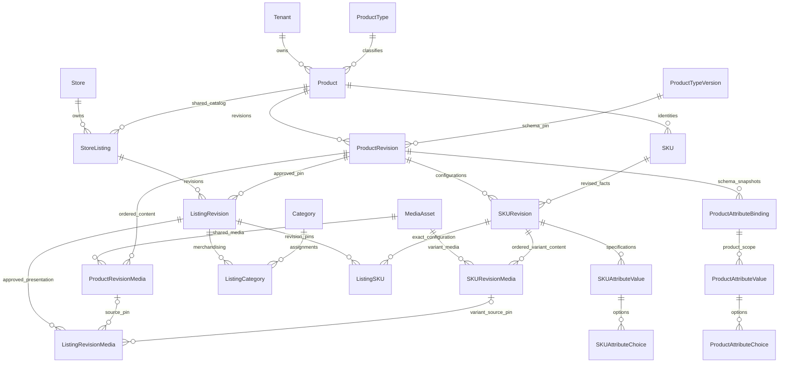

# Milestone 4 — Catalog revisions, explicit SKUs and store listings

Branch: `feature/commerce-products-variants`, based on Milestone 3 `c2c0302`.
The work is local only. No production migration, import, restart, deployment,
scheduled operation, push or merge is included.

## Implemented boundaries

| Ownership | Entities and responsibility |
|---|---|
| Tenant | `Product`: permanent UUID/code/Product Type and optional legacy external reference; publication pointer and optimistic root revision |
| Tenant | `ProductRevision`: name/slug, manufacturer reference, plain structured content, pinned approved schema, selling policy, review/publication history |
| Tenant | `ProductAttributeBinding`: exact approved field snapshot, scope, required flag and selected axis; typed Product values and option-choice rows |
| Tenant | `SKU`: permanent internal code, separate manufacturer part number and canonical physical combination identity, retained after archival |
| Tenant | `SKURevision`: configuration inside one exact ProductRevision; typed SKU values and option-choice rows |
| Tenant | `CatalogBrand`: controlled manufacturer/brand references, not executable metadata |
| Store | `StoreListing`: merchandising identity for a tenant-owned product, optional legacy external reference, publication pointer and root revision |
| Store | `ListingRevision`: exact approved ProductRevision pin, title/slug/SEO/visibility/editorial ordering and immutable publication history |
| Store | `ListingCategory`: many assignments to categories in this store; `ListingSKU`: pins only SKU revisions belonging to that same ProductRevision |
| Tenant/store presentation | Media reference contracts described below; no upload or public media pipeline |

The additive `202611010004_catalog_products` migration adds 18 tables and four
enums, extends route ownership with `LISTING`, and adds a reviewed `allowNoSku`
policy to Product Type versions. Existing identity/session/schema/category/filter
records are preserved. No category-specific tables, price tables, inventory tables
or order tables were added.



## Attribute validation and SKU identity

All values use typed columns: text, exact `Decimal(24,6)` numbers with the pinned
canonical unit, Boolean, or normalized option-choice rows. Missing values are
omitted, not converted into false, zero or an empty string. Required fields are
checked at review, approval and publication. Numeric bounds, steps and controlled
vocabulary come from the approved snapshot; no float coercion or executable rules
are accepted. Product and SKU scopes are checked in services and database guards.

A product's Product Type is an identity relationship. A draft can select another
approved version of that same type; moving to a different type requires an
explicit new product identity. Store categories remain independent and may mix
Product Types. Product-level facts are not duplicated into every SKU.

Selectable axes must be approved, axis-eligible, active single-select SKU fields.
Other SKU specifications, such as a sensor or a technical measurement, need not
be axes. The server hashes the sorted array of stable attribute/option UUID pairs
using SHA-256. It never derives combinations from labels, descriptions or images.
Duplicate combinations within a ProductRevision are database-unique. Axis ordering
for dependent selection follows the schema's display order with a stable ID tie
break; the canonical combination hash is independent of input order.

SKU codes are case-sensitive and unique per tenant across archived identities.
An existing SKU's code, product owner, part number and physical axis facts cannot
be rewritten. Use a new identity for a physically different configuration.
Technical specification corrections are versioned, approved facts; previous SKU
revisions remain intact. Several historical identities may represent the same
axis combination across different product revisions, but only one such
configuration can occur in any single revision.

The API accepts at most 50 explicitly entered SKUs, 40 attributes per value scope
and 8 selected axes per product revision. It creates no Cartesian products.
Products without axes have one default SKU when their policy requires SKUs.
SKU-free products are permitted only for `RFQ` or `INFORMATIONAL` and only when
their approved Product Type version has `allowNoSku=true`. The Product Type editor
exposes that reviewed policy; it is immutable outside draft schema versions.

The resolver returns `PARTIAL`, `RESOLVED`, `NONEXISTENT` or `ARCHIVED`, the matching
SKU identity/specifications, retained choices, incompatible downstream choices
to clear and valid subsequent values. Changing an upstream choice does not erase
compatible downstream choices. A sensor can be returned as a derived SKU fact
without appearing as a selectable option. Pricing and inventory are explicitly
null/not implemented, never inferred as available or in stock.

## Revisions and publication

Lifecycle: `DRAFT → IN_REVIEW → APPROVED → PUBLISHED → ARCHIVED`. Review may return
to draft. Reviewed facts require cloning before changes. One draft and one
published revision per root are enforced by partial indexes. All reviewed child
rows, values, choices, SKU configurations and presentation references are frozen
by database triggers. Root identities and routing reservations are retained.

Product/SKU edits require tenant permissions. Listing publication requires store
permissions and cannot edit the shared catalog. Approval and publication are
separate capabilities. Publication checks the revision counter and root counter,
archives the previous published revision and updates the pointer transactionally.
Deferred constraints verify pointer consistency. Competing publications using one
observed root revision cannot both succeed. Normal session/audit behavior remains
the existing implementation; legacy Owner is not SaaS Platform Super Admin.

Store listings may pin an approved ProductRevision before the tenant marks it as
its current published revision. An already published historical revision remains
valid as a stable pin when superseded; that does not switch other stores to new
facts. New pins use approved/published facts or formerly published historical
facts, not unapproved drafts or abandoned unapproved archived revisions. Updating
a store to newer shared facts is an explicit listing draft, validation, approval
and publication operation. `ListingSKU` composite FKs reject even another approved
SKU revision of the same product if it belongs to the wrong ProductRevision.

Reference browsing, informational, RFQ and retail policies are distinct. A listing
inherits its product revision's policy; it cannot promote a reference-only product
into retail by setting a body field. **Every policy remains non-purchasable in
Milestone 4.** No price approval, inventory eligibility, checkout or availability
service exists here. Catalog drafts have no pricing/stock fields, so publishing
cannot overwrite future operational balances or selling prices.

Archiving a product identity blocks while nonarchived store listings reference
it. SKU identity archival blocks while approved/published listing pins depend on
it. Archiving listing identities preserves revision/route history. Public routing
is not cut over; a future public resolver must honor root archival and visibility
as well as immutable historical pins.

## Real schema/category/filter impact

`SchemaUsageService` now queries actual tenant-owned ProductRevisions, SKU
revisions and listing references. It compares candidate schemas against saved
typed facts and reports missing required fields, removed fields, scope/axis/unit
changes, invalid vocabulary/rules and SKU-free-policy incompatibility. It reports
affected revision IDs and reasons plus schema-filter dependency counts.

Unsafe activation blocks when approved facts or listing pins conflict. Existing
products are never automatically moved to a new schema. Mutating a shared
attribute's semantic validation, units, visibility, status or allowed scopes is
also blocked once approved product facts depend on it; create a new reviewed
attribute/schema migration instead. Approved schema snapshots remain frozen.
Analysis loads at most 500 revisions and returns at most 25 detailed conflicts;
truncation is explicit and blocking. A later reviewed migration workflow is
required for larger catalogs, rather than pretending incomplete analysis is safe.

Category usage now counts real store listing assignments. Archival blocks on
usage; compatibility restrictions are checked against actual listing Product
Types. Filter impact includes descendant assignments and blocks activation when
existing applicable listing pins use an incompatible schema version. This is
dependency safety, not a live search engine or facet aggregation implementation.

## Promotional posters and other media — relationship contracts

Media is separate from specification JSON. `MediaAsset` is tenant-owned and
contains identity, optional content digest/storage reference, MIME type/dimensions,
source URL, rights status/evidence, archival state and audit actor/time. A new
asset defaults to `UNVERIFIED`; reuse is never implied by an image's existence.

`ProductRevisionMedia` and `SKURevisionMedia` distinguish shared and variant
content. `MediaPurpose` separates `GALLERY`, `DETAIL_POSTER`, `SIZE_CHART`,
`DIMENSIONS`, `INSTALLATION_GUIDE`, `FEATURE_DIAGRAM` and `OTHER_CONTENT`.
Each reference has purpose/order, alternative text, optional caption, visibility
and bounded responsive-presentation metadata. There can be zero or many posters.
Ordering is unique within a revision/purpose, so gallery order and poster order
are independent. SKU media is pinned to an exact SKU/ProductRevision relationship.

`ListingRevisionMedia` pins exactly one product- or SKU-media source from its exact
approved ProductRevision. Its store/tenant/revision FKs reject foreign
presentation sources. The listing may retain ordered alt/caption/visibility and
presentation settings separately from shared product facts. Reviewed/published
references freeze; clone operations retain media references in new drafts.
Referenced asset bytes/source/rights evidence cannot be changed under reviewed
facts; replacement requires a new asset identity. Rights revocation/archive must
be honored by the later delivery layer, not bypassed through a historical pin.
Unverified or archived assets block approval of product facts carrying them.

No media upload/assignment HTTP endpoints, external fetches, image processor,
Cloudinary configuration or storefront poster renderer were added. Media tests
insert synthetic metadata in the isolated database, with no actual image file or
rights inference. A listing with pinned media cannot silently change its product
revision through this milestone's general editor: it requires a later explicit
media-presentation review.

Milestone 5 must implement tenant `media.manage` plus product/SKU assignment
authority, and store listing-presentation authority, before exposing writes.
Validate a declarative responsive registry (bounded widths, aspect/fit/loading
and alignment), URLs/storage keys, MIME/size/dimensions and source rights; never
accept executable templates or arbitrary delivery expressions. Variant posters
must belong to a selected listing SKU. Support batch uploads, keyboard-accessible
reordering as well as drag-and-drop, sequence preview, replacement/archive usage
checks, alt text and visibility. Delivery must request suitably sized optimized
images, use dimensions to avoid layout shift, and lazy-load below-the-fold posters
instead of downloading full-resolution originals. Optional gallery video support
belongs to that media milestone. Public placement below product information and
specifications belongs to storefront integration, without industry-specific code.

## Admin and APIs

`/products` and `/variants` open the same tenant-scoped generic product/SKU editor.
`/listings` opens the store-scoped publication workspace. Both use the existing
admin shell, context selection, forms, responsive styles and protected routing.
Product forms are generated from approved field snapshots and separate PRODUCT
from SKU scopes. Missing Booleans are a separate input option from “No”. Editors
support explicit combinations, manufacturer references, safe content, selling
policies, dependent-selection preview, validation, comparison, history and clone
workflows. Listing forms select approved catalog revisions, exact SKU pins,
multiple published categories, SEO/visibility and editorial ordering.

Product/SKU base: `/api/admin/scopes/tenants/:tenantId/catalog`:

| Method | Relative route | Capability |
|---|---|---|
| GET | `/schemas`, `/brands`, `/products`, `/products/:id`, `/products/:id/revisions[/:rev]`, `/:rev/impact` | `products.view` |
| POST | `/brands` | `products.update`, audited |
| POST | `/products` | `products.create`, plus SKU/axis permissions for submitted configurations |
| PATCH | `/products/:id/revisions/:rev` | `products.update`; explicit SKU payload also requires `skus.update` |
| POST | `/products/:id/revisions/:rev/clone` | `products.update` |
| POST | `/products/:id/revisions/:rev/resolve` | `products.view` |
| POST | `/products/:id/revisions/:rev/actions/{review,draft,approve,publish,archive}` | `products.submit/update/approve/publish/archive` respectively |
| POST | `/products/:id/archive`, `/products/:id/skus/:sku/archive` | `products.archive`, `skus.archive` respectively |

Creating SKU identities requires `skus.create`; removing/changing configuration
archive state requires `skus.archive`; changing selected axes requires
`variants.manage`. Sending no SKU payload allows a product metadata edit without
acquiring SKU-edit authority. Internal SKU codes and part numbers are separate.

Listing base: `/api/admin/stores/:storeId/listings`:

| Method | Relative route | Capability |
|---|---|---|
| GET | `/`, `/:id`, `/:id/revisions[/:rev]`, `/:id/revisions/:rev/impact` | `listings.view` |
| GET | `/catalog`, `/categories` | `listings.view`; safe approved selection metadata only |
| POST/PATCH | `/`, `/:id/revisions/:rev` | `listings.create/update`; category changes require `listings.assign-categories` |
| POST | `/:id/revisions/:rev/clone` | `listings.update` |
| POST | `/:id/revisions/:rev/actions/{review,draft,approve,publish,archive}` | `listings.submit/update/approve/publish/archive` respectively |
| POST | `/:id/archive` | `listings.archive` |

Collection/history APIs have bounded pagination (up to 25 per page); root history
previews show the latest 25. All mutation DTOs are strict, with plain-text and
declarative content only. Stale revisions conflict with HTTP 409. Cross-scope
membership fails with 403; missing scoped resources return 404; malformed facts
and incompatible references return 400. No global identity permission union
replaces scoped authorization.

`/api/admin/contexts/products` selects authorized tenant contexts; existing catalog
contexts include authorized listing stores. Store staff may select approved
catalog metadata without gaining tenant schema-edit rights. Custom roles need
explicit new capabilities; production permission provisioning remains a separate
reviewed operation, not automatic promotion of existing staff.

The BFF forwards only registered routes/methods and bounded collection queries.
It retains HttpOnly cookies, CSRF/Origin checks, preview fail-closed behavior,
session revocation and the existing 16 KiB mutation cap. Large configurations
with long text may therefore need fewer rows than the absolute item limits. No
unrestricted proxy, credential exposure or authentication replacement was added.

## Existing 84-product compatibility

The static 84 products, 12 categories and all URLs remain unchanged. No real
product records are imported into production or guessed from marketing copy.
`scripts/plan-legacy-catalog.mjs --summary` is a read-only future-import plan: it
preserves source IDs as `externalReference`, slugs, category mapping, source/editorial
order, reference-only PKR prices, inventory evidence and media paths/rights.
It does not assign variants, infer stock, approve prices or assign posters.
Permanent external-reference uniqueness provides idempotent mapping contracts
without forcing non-UUID legacy IDs into new internal UUID columns.

The actual importer must be independently reviewed, development-tested and
explicitly approved later. It must use reviewed Product Type mappings, reserve
existing routes, retain reference-price provenance and unknown inventory, preserve
Featured/New Arrivals order and respect development-only media restrictions.
`CatalogRoute` now supports immutable listing ownership alongside category and
legacy reservations. Collisions stop with 409; previous slugs stay reserved.
There is still no database-driven public resolver or storefront read cutover.

## Reproduction and evidence

```powershell
cd D:\work\coding\vog\backend
npm run test:products
npm run test:foundation
npm run lint
npm test
node scripts/plan-legacy-catalog.mjs --summary
cd ..\admin
npm run lint
npm run test:routing
npm run test:preview
node scripts/test-scoped-routes.mjs
```

The product harness also runs Product Type and category/filter regression tests.
It creates disposable random-port loopback PostgreSQL/Nest processes, random
in-memory development credentials and an env-free built admin fixture, then stops
and removes them. It verifies the migration on populated Milestone 3 records,
not only an empty database. Browser checks use the real Next.js BFF, real login,
real Nest services and real PostgreSQL; no mock authentication claims.

Fixtures cover default retail, three actual keyboard combinations, color-derived
mouse sensors, apparel and SKU-free inquiry vehicles. Tests cover immutable facts,
canonical identities, stale/concurrent writes, real schema impact, store pins,
scope/RBAC/CSRF failures and optional media relationship contracts. Frontend
source-identity checks preserve the static catalog.

Sanitized evidence lives in `backend/docs/products-*.json`. Existing milestone
reports remain historical evidence. Dependencies are unchanged; development-tool
advisories are reported separately from production audits. Local builds, generated
Prisma clients, fixture databases, operational `.local` artifacts, keys and
unrelated untracked frontend assets are excluded from the commit.

Pricing, stock, uploads/delivery, poster rendering, public filtering/facets,
checkout, catalog import and public cutover remain the explicitly excluded later
milestones. No Milestone 5 functionality or Stage 4 operational automation is
activated by this branch.
