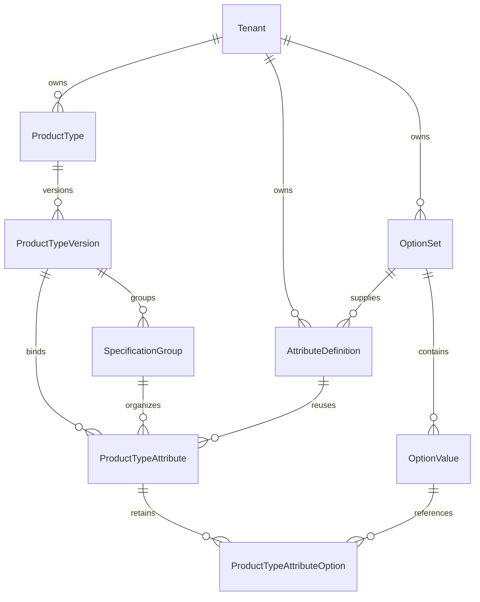

# Milestone 2 — tenant Product Types and reusable attributes

Implemented locally on `feature/commerce-product-types`, based on Milestone 1 commit `d9fd4aa`. No production database, Oracle service, Vercel settings, Owner credentials, storefront catalog or dormant operations automation was changed. Do not deploy or apply this migration to Neon without a separate reviewed rollout.

## Model and ownership

Product Types are independent of categories. Every definition, vocabulary, version, group and binding belongs to one tenant. Compound foreign keys preserve that ownership in nested writes and joins.



- `AttributeDefinition`: stable tenant-unique code, immutable type/vocabulary identity, label/description, exact validation metadata, canonical unit, supported control, allowed PRODUCT/SKU levels, axis eligibility, visibility, lifecycle and optimistic revision. Requiredness is **only a Product Type binding rule**, never globally attached to a reusable attribute.
- `OptionSet` / `OptionValue`: tenant-owned reusable vocabularies, stable IDs/codes, labels, sort order, optional six-digit hex swatches and ACTIVE/ARCHIVED state. Existing options must remain in replacement updates; unused ones can be archived. Referenced values cannot be deleted or archived, and referenced sets cannot be archived. There are no deletion endpoints.
- `ProductType`: stable code, optimistic activation revision, and an active-version pointer constrained to a version of the same type and tenant.
- `ProductTypeVersion`: numbered lifecycle, label/description, optimistic revision, approval actor/time, ordered groups and attribute bindings. One DRAFT and one ACTIVE version per type are enforced by partial unique indexes.
- `ProductTypeAttribute`: one binding per attribute/version; exact PRODUCT or SKU ownership, requiredness, axis flag, ordering, group, and a server-created immutable snapshot. `ProductTypeAttributeOption` retains relational references to the option identities captured by that snapshot.

The snapshot includes labels, descriptions, data type, unit, effective validation, widget, visibility, source revisions and the exact ordered options with labels/swatches. Changing the reusable definition or an option label never changes an approved version. Saving a draft explicitly refreshes its bindings from current active definitions; cloning alone preserves the original snapshot.

The migration adds eight models and four enums; it does not insert demo schemas or alter existing authentication records. SQL CHECKs, a non-null/deduplicated scope array, partial indexes, immutable-identity triggers, reviewed-schema child triggers and deferred active-pointer consistency triggers supplement Prisma's compound foreign keys. Retain these manually specified SQL invariants when reviewing future Prisma-generated diffs; they are not all expressible by Prisma schema syntax. Reviewed children cannot be inserted, edited or deleted even through ordinary direct SQL writes. Database administrators who can disable triggers remain inside the privileged database trust boundary.

## Data types, units and validation

Supported types are TEXT, NUMBER, BOOLEAN, SINGLE_SELECT and MULTI_SELECT. NUMBER means an exact decimal, not a JavaScript float. Numeric rules use decimal **strings**, with at most 18 integer and six fractional digits; conversion arithmetic uses a local 80-digit Decimal context. Future product values must use the same canonical representation.

The server-owned registry supports length/distance, mass, frequency, bit data rate, transfer rate, storage, power, time and dimensionless numbers. Distance uses the length dimension (`mm`, `cm`, `m`, `km`). Decimal GB and binary GiB are distinct. MT/s cannot be converted into Mbit/s or Hz. Conversions require matching registered dimensions and reject overflow or precision loss; no administrator-defined formulas, expressions, SQL or conversion functions are accepted. Units are selected from the registry, not created through an API.

| Type | Permitted validation | Controls |
| --- | --- | --- |
| TEXT | minLength, maxLength, literal allowedValues | text, textarea |
| NUMBER | exact-string min/max/step/allowedValues; grid anchored at min or zero | number |
| BOOLEAN | no executable or extra rules; false remains valid | checkbox |
| SINGLE_SELECT | registered active option vocabulary | select, radio, swatch |
| MULTI_SELECT | minItems, maxItems and registered choices | multiselect, checkboxes |

Bindings may narrow definition validation, never widen it. Increments must preserve the original numeric grid. Required fields must be visible in administration forms. A variant axis requires an eligible SINGLE_SELECT attribute at SKU level; arbitrary free text is not an axis. No combinations or SKU rows are generated.

Metadata is plain text and strict declarative JSON. Markup, unknown widgets, arbitrary regexes, remote templates, event handlers, unknown rules and unregistered units are rejected. Swatches accept only `#RRGGBB`. React renders text and a fixed widget map; there is no raw HTML, dynamic evaluation or executable administrator schema.

## Lifecycle and impact

`DRAFT → REVIEW → APPROVED → ACTIVE → ARCHIVED`

REVIEW may return to DRAFT. DRAFT/APPROVED may be archived; an active version requires both archive and activation authority to withdraw. Approved/active/archived content is immutable. To edit an active type, use **Create new draft from version**. A direct PATCH against an active version returns 409.

Draft writes and transitions require the current version revision. Activation additionally requires the current Product Type revision obtained from the impact response. The transaction recalculates impact, archives the previous active version, activates the candidate and changes the pointer atomically. Serializable retries plus the existing shared authorization write lock handle concurrent requests; stale concurrent activation returns 409. SQL enforces one active version and a consistent pointer at commit.

The comparison reports added, removed and changed attributes, group/label changes, the current active version and type revision. `SchemaUsageService` is the replaceable impact-analysis boundary. Its explicit current mode is `NO_PRODUCT_MODEL` with zero references because this milestone deliberately has no product tables. Unknown counts or blocking reasons fail activation closed. **Before Milestone 3 permits product publication, replace this adapter with tenant-scoped Product/ProductRevision usage and compatibility checks.** The current result is not evidence about hypothetical products or existing static storefront data.

## Scoped authorization and admin

All schema capabilities are TENANT-only:

```
product-types.view / create / update / approve / activate / archive
attributes.view / create / update / archive
option-sets.view / manage
```

Milestone 1's `product-types.manage` remains registered for compatibility but is not an implicit grant of the new granular capabilities. New custom roles must explicitly receive their intended permissions and delegation boundary. Example editor: product-types.view/create/update, attributes.view/create/update, option-sets.view/manage. An approver can have product-types.view/approve without update/activate; an activator needs view/activate. Attribute archival also requires update. No scope widening is inferred from a Store Administrator title, platform role or client header.

Every mutation reauthorizes inside the existing serializable scoped transaction and emits a tenant audit event (`schema.*`). The default legacy VOGPK Owner retains these new capabilities only through the existing default tenant bridge. Password hashes, sessions, login/logout, existing roles and CSRF/BFF behavior are preserved.

`GET /api/admin/contexts/schema` returns up to 25 authorized tenant configuration contexts, with permission names for navigation. The admin's server session helper keeps those separate from legacy global permissions. A 404 fallback preserves old-backend navigation during review; it does not grant access. No tenant onboarding is enabled. Tenant selection remounts the workspace and aborts old collection requests.

Admin pages:

- `/attributes`: searchable/paginated attribute and option-set management, typed validation controls, stable code/type editing boundaries, canonical units, scopes, visibility and permitted archival.
- `/product-types`: searchable/paginated types, recent and paginated older versions, draft groups/bindings, ownership/axis settings, generated preview, compare/impact, review/approval/activation/archive and cloning.
- The generated preview includes exact decimal, literal text, option identity and selection-count validation. Preview validation writes nothing; future product APIs must validate facts again on the backend. A required Boolean means present, not necessarily true.

All new BFF paths are explicitly allowlisted by method and canonical UUID shape. Only schema collection/history reads forward query strings, and Nest validates their keys and bounds. Existing Origin/CSRF checks, HttpOnly SameSite cookies, 16 KiB streamed mutation cap, session enforcement, preview fail-closed behavior and no-store responses apply unchanged. No generic proxy or public schema endpoint exists.

## API contract

Base: `/api/admin/scopes/tenants/:tenantId/schema`. All requests need the existing real session and BFF authentication; browser callers use the admin BFF, never the bridge secret.

| Method / relative path | Capability / behavior |
| --- | --- |
| GET registry | Any schema read capability; safe unit/widget registry |
| GET attributes | attributes.view; paginated definitions with vocabulary metadata |
| POST attributes | attributes.create; create stable definition |
| PATCH attributes/:id | attributes.update, plus attributes.archive for state changes; revision required |
| GET option-sets, GET option-sets/:id | option-sets.view; scoped vocabularies |
| POST option-sets | option-sets.manage; generated value IDs |
| PATCH option-sets/:id | option-sets.manage; revision required, preserve existing IDs/codes |
| GET product-types | product-types.view; paginated type list and recent version summaries |
| POST product-types | product-types.create; root plus initial empty draft |
| GET product-types/:typeId/versions | product-types.view; paginated version history |
| GET product-types/:typeId/versions/:id | product-types.view; private saved schema snapshot |
| PATCH product-types/:typeId/versions/:id | product-types.update; full draft groups/bindings replacement |
| GET product-types/:typeId/versions/:id/impact | product-types.view; diff and usage interface |
| POST product-types/:typeId/versions/:id/clone | product-types.update; source revision required |
| POST product-types/:typeId/versions/:id/actions/:action | update for review/draft, approve, activate or archive capability for the respective action |

Collection query: `page=1&pageSize=20&search=...&sort=code&direction=asc`, with optional ACTIVE/ARCHIVED status for attributes/sets. Page size is capped at 25, search at 80 characters, and sort is code/label/createdAt only. Version history accepts page/pageSize and sorts by descending version number. Inputs reject unknown fields. Typical responses use existing safe 400/401/403/404/409 errors without database diagnostics.

Attribute example:

```json
{"code":"polling_rate","label":"Polling rate","dataType":"NUMBER","canonicalUnit":"Hz","widget":"number","allowedScopes":["PRODUCT","SKU"],"axisEligible":false,"visibility":{"admin":true,"storefront":true},"rules":{"min":"125","max":"8000","step":"125"}}
```

Draft replacement:

```json
{"revision":1,"label":"Example type","description":"","groups":[{"code":"general","label":"General","sortOrder":0}],"fields":[{"attributeId":"<owned-attribute-uuid>","groupCode":"general","level":"PRODUCT","required":true,"variantAxis":false,"sortOrder":0,"widget":"number","rules":{},"visibility":{"admin":true,"storefront":true}}]}
```

Transition: `{"revision":4}`; activation/active archival: `{"revision":4,"typeRevision":1}`. Client-supplied snapshots, tenant IDs inside DTOs, executable controls and arbitrary role flags are not accepted.

## Development verification and migration gate

From backend:

```powershell
npm run test:product-types
npm run test:foundation
npm run lint
npm test
npm run db:validate
```

From admin:

```powershell
npm run lint
npm run test:routing
npm run test:preview
node scripts/test-scoped-routes.mjs
node scripts/test-schema-preview.mjs
```

The product-types suite owns a new random-port loopback PostgreSQL cluster, applies all three migrations, uses synthetic accounts and in-memory credentials, builds/runs an environment-free copy of the admin, and drives real Microsoft Edge browser workflows through Playwright. The browser dependency is development-only and uses the existing installed Edge; no browser or paid infrastructure is provisioned. Test clusters, APIs and admin fixtures are stopped/removed. No user-provided DATABASE_URL is used by that runner. Tests use the installed PostgreSQL 18.4 test binary, not production Neon 18.6.

The additive migration is `202611010002_product_types`. Production application deployment is not approved. A future rollout requires separate approval for the foundation/schema migrations and a reviewed tenant/permission backfill. The development-only initializer can register new permission scopes on a disposable, already migrated loopback development database; it must never be pointed at Neon. There is no schema seed at API startup, and demo keyboard/clothing/vehicle records exist only in disposable tests.

## Verification evidence and remaining boundaries

See `backend/docs/product-types-verification.json` and `backend/docs/product-types-foundation-regression.json` for sanitized execution evidence. The new suite covers fresh migrations, reusable definitions, tenant uniqueness, invalid configuration, industry fixtures, narrowed validation, SQL and API immutability, option protections, concurrent activation, tenant isolation, scoped/granular permission denial, real admin forms/lifecycle, desktop/mobile overflow and audit hygiene. Existing login/logout/session/Owner/RBAC/CSRF/BFF tests are also rerun.

Local verification on 2026-11-01 (Asia/Karachi):

| Check | Result |
| --- | --- |
| Prisma schema and NestJS production build | PASS |
| Backend unit tests and lint | PASS — 12 tests across four files, no lint findings |
| Product Type isolated integration suite | PASS — 12 test groups, including eight real browser workflow/responsive checks |
| Existing scoped foundation and authentication | PASS — 23 foundation groups and 25 authentication checks |
| Real isolated admin production build and BFF/CSRF/session regression | PASS — 15 HTTP/security checks; no browser credentials persisted |
| Admin lint and routing configuration | PASS — no lint findings; 19 routing checks |
| Exact schema-preview and existing proxy-negative tests | PASS — six preview assertions and 57 proxy assertions |
| Secret-free Preview configuration/build/HTTP | PASS — 10 configuration checks and 38 build/HTTP checks, zero backend requests |
| Runtime npm dependency audit | PASS — zero production findings |
| Cleanup | PASS — temporary PostgreSQL, NestJS and admin processes stopped; generated database/build directories removed |
| Staged secret scan | PASS — Gitleaks 8.30.1, zero findings; credential/backup paths and private-key markers checked separately |

Backend production dependencies have zero npm audit findings. Two moderate **development-only** findings remain in the pre-existing `@nestjs/cli` / `minimatch` chain; those package versions were already present in `d9fd4aa`. No forced framework upgrade is included. Node's existing admin module-type warning is non-failing.

Ready for Milestone 3 development review. Actual product facts, Product/SKU persistence, dependent SKU combinations, categories, pricing, stock, media, storefront filters and public schema delivery remain unimplemented. Required next integration: product-level/SKU-level fact validation, real usage/compatibility analysis, schema pinning and the approved catalog import. No production readiness or deployment is claimed by these local tests.

## Changed-file map

| Files | Purpose |
| --- | --- |
| backend/prisma/schema.prisma; new product-types migration | Tenant-owned schema models, compound FKs, lifecycle and immutable snapshot invariants |
| backend/src/product-types/registry.ts; validation.ts; registry.spec.ts | Exact units, supported controls, strict metadata and narrowing rules, precision tests |
| backend/src/product-types/product-types.service.ts; product-types.controller.ts; product-types.module.ts | Authorized private schema APIs, paginated reads, optimistic writes, snapshots and transitions |
| backend/src/product-types/impact.service.ts | Replaceable explicit empty-product-model usage boundary |
| backend/src/app.module.ts | Register the domain module without coupling it into authentication |
| backend/src/security/scoped-permissions.ts; scoped.controller.ts | Tenant-only granular capabilities and authorized navigation contexts |
| backend/scripts/test-product-types.mjs | Disposable PostgreSQL, API, authorization, lifecycle and real browser verification |
| backend/scripts/foundation-admin-regression.mjs | Optional in-memory browser exercise hook; original regression behavior preserved |
| backend/package.json; package-lock.json | New test command and development-only Playwright dependency |
| admin/src/components/schema/SchemaWorkspace.jsx; AttributePanel.jsx; ProductTypePanel.jsx | Authorized tenant selection and usable attribute/vocabulary/type management |
| admin/src/components/schema/SchemaFields.jsx; GeneratedPreview.jsx | Safe typed controls and declarative interactive preview |
| admin/src/lib/schema-preview.js; admin/scripts/test-schema-preview.mjs | Exact, non-persistent preview validation and negative/value-type tests |
| admin/src/lib/scoped-routes.js; admin API catch-all route | Explicit schema proxy methods and bounded validated collection query forwarding |
| admin/src/lib/session.js; config/modules.js; components/AdminShell.jsx | Scoped navigation metadata kept separate from legacy global permissions |
| admin protected module page; app/layout.jsx; styles/schema.css | Existing layout integration and responsive configuration styling |
| admin/scripts/test-preview-http.mjs | New schema pages/APIs remain disabled in secret-free previews |
| new backend/docs/product-types-*.json; this document | Sanitized verification, implementation, API and migration documentation |
